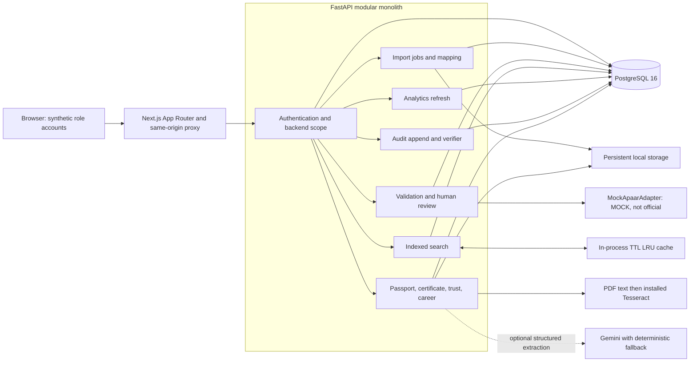
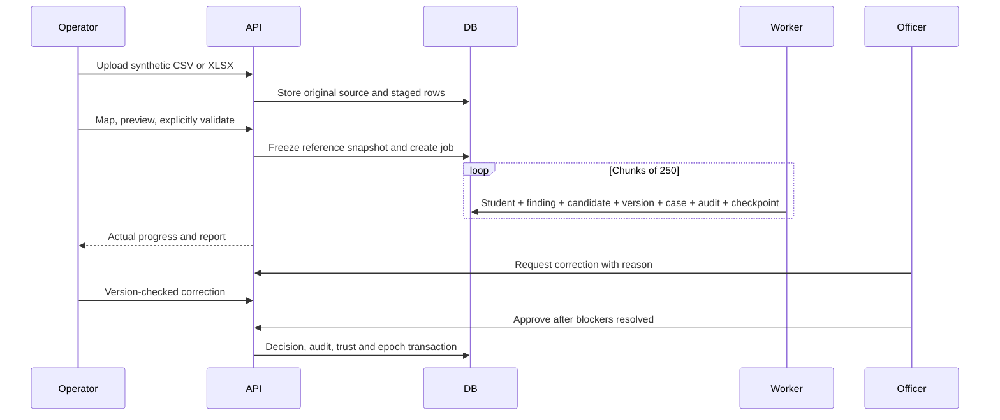

# Architecture

The browser calls a Next.js same-origin proxy, which injects the HttpOnly access cookie as a bearer token. FastAPI checks the current database user and assignments on every protected request. All data lives in one PostgreSQL database. Persistent uploads use the local storage volume; fixtures are synthetic and versioned.



```mermaid
sequenceDiagram
 Browser->>Next: Search with filters and cookies
 Next->>API: Inject access token
 API->>DB: Active user, scope and institution epoch
 API->>Cache: Scope + user + epoch + filters
 alt Cache miss
 API->>DB: Exact count and indexed page
 API->>Cache: Store scoped rows; omit timer
 end
 API-->>Browser: Rows, total, fresh API timing, HIT or MISS
```



The API entry point now owns transport, errors, lifecycle and health checks and registers twelve domain routers. Auth, institutions, career and trust have separate schemas, service policy and repositories. Import mapping/rules/matching, certificate extraction/OCR/risk and audit canonicalization are separate modules. Some remaining domain routers still contain SQL and service policy; completing their service/repository extraction remains V2. Web screens still share components/workspace.tsx; table, badge, loading/error view, page heading, formatting and the shared data hook are extracted into their own modules. Tables have 32/44 px row-density controls hidden in print. The exact required tree is not complete; see the artifact report and S1 in the owner register.
