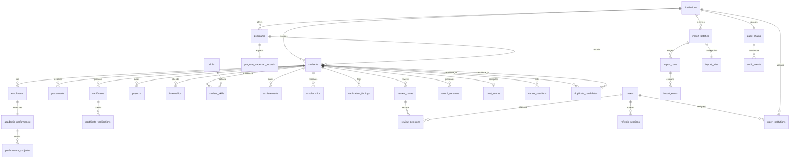

# Relational model

The executable contract is `db/schema.sql`; migrations execute its three constituent SQL files in order. Constraints prevent invalid canonical identifiers and enforce institution/program consistency. Incomplete submitted values stay in staging and nullable shell fields.

The system audit chain has a nullable institution. Student program/profile values may be absent for incomplete imports. Officer assignments are many-to-many; administrator access never becomes an institution impersonation.
